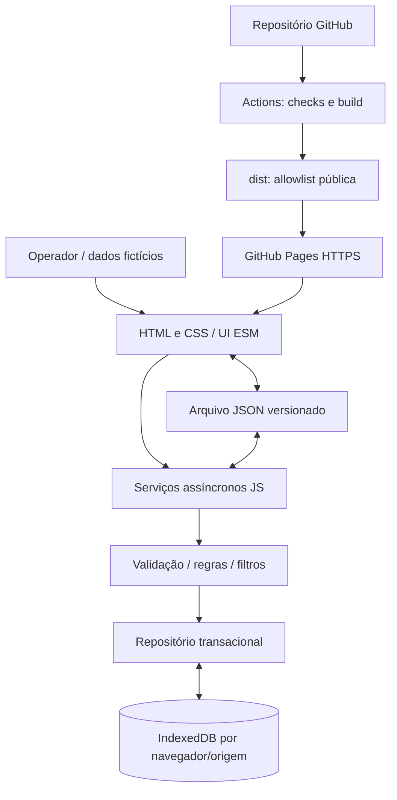

# 03 — Arquitetura estática

Versão do contrato: 1. Estado: proposta documental G2, sujeita à revisão independente; sem aplicação implementada. Normas de domínio: specs 01–02; operação: spec 09; publicação: spec 10; identidade: spec 11.

## Decisão técnica

HTML semântico, CSS e JavaScript ESM vanilla, sem framework, API HTTP de dados, SQLite remoto, CDN, service worker ou dependências de runtime externas. Node executa build e testes; o navegador executa UI, serviços e IndexedDB. O servidor local apenas entrega arquivos estáticos. GitHub Pages entrega o mesmo `dist/`.

Build planejado: `node scripts/build.mjs`, usando apenas módulos nativos de Node para validar/copiar uma allowlist. Testes: `node --test`, com domínio puro no Node e persistência real no Playwright; QA real: Playwright/Chromium. Runtime bundled é alternativa local, nunca caminho embutido no site. Versões observadas e smoke do ambiente devem constar em evidence/G2; G3 declarará dependências e lockfile para instalação reproduzível fora deste computador.

## Componentes e responsabilidades

| Componente futuro | Função / limite |
|---|---|
| `index.html`, `src/main.js`, `src/ui/` | Bootstrap, navegação hash, formulários, leitura de arquivo/download e feedback acessível; não escreve IndexedDB diretamente |
| `src/domain/` | Normalização, validação, estados, filtros, unicidade e serviços assíncronos da spec 04; independente do DOM |
| `src/storage/` | Abrir/migrar DB, ler snapshot e executar mutação transacional; traduz erros nativos; não conhece HTML |
| `src/data/seed.js` | Dados fictícios determinísticos de demonstração, UUID/timestamps fixos válidos, no mínimo instituição com duas ofertas |
| `public/` | Assets originais necessários e públicos; sem fontes de referência privadas |
| `scripts/` | Build, servidor estático, checks e QA; não incluídos em dist |
| `tests/` | Contratos/domínio/repositório e cenários de navegador; não incluídos em dist |
| `design/preview/` | Consulta/formulário estáticos de design, sem persistência; não é aplicativo nem artefato Pages |

Entrada/processamento/saída exemplificados: operador informa DEMO-EMP-001, Cidade Alfa/RS e oferta de água → serviços normalizam/validam instituição e oferta, verificam duplicidade e escrevem snapshot → consulta mostra quantidade/unidade e disponibilidade declarada. Ao filtrar agua + RS, serviço lê um snapshot consistente e retorna ofertas ordenadas, com instituição correspondente. Nada é enviado a um backend de dados.

## Armazenamento e concorrência

Banco `cadastro-doadores-institucionais`, versão IndexedDB 1. Store `estado`, keyPath `chave`, dois registros: `snapshot` e `meta`. Snapshot `{chave:'snapshot', instituicoes:[], ofertas:[]}`; meta `{chave:'meta', inicializada:true, revisao:1}`. Versão JSON 1 e versão IndexedDB 1 são conceitos distintos. Não armazenar `exportedAt` como data das entidades.

Toda escrita abre **uma única transação readwrite sobre estado**, lê os dois registros dentro dela, calcula o novo snapshot com funções síncronas puras, valida o conjunto, escreve snapshot+meta e aguarda `complete` antes de resolver. Não fazer leitura prévia fora da transação para depois salvar snapshot obsoleto; não aguardar rede, timer, leitura de arquivo ou promise alheia entre requests IndexedDB. Transações readwrite concorrentes desta store serializam a leitura-modificação-gravação inclusive entre abas. Uma fila somente em memória não satisfaz esse requisito. Não manter cache autoritativo; cada serviço lê o estado atual. Edição usa também `expectedUpdatedAt` para detectar formulário obsoleto; importação/restauração usam revisão esperada da base (spec 04).

Criação inicial/seed, cascata de desativação, importação e restauração são atômicas. Meta inicializada impede seed em base vazia intencional. Falha/abort não altera snapshot nem revisão. `versionchange` fecha conexão; `blocked` informa fechar outras abas. Política de migração em spec 09.

## Distribuição e dados

ESM com imports relativos; URLs de CSS/JS/assets relativas a `index.html`; nenhuma URL iniciada em `/src` ou `/assets`. Hash `#/ofertas`/`#/instituicoes` não altera caminho de documento. Raiz e `/arquitetura_convergentes/` devem servir o mesmo build, inclusive na recarga. Não usar `file://`.

Limites de projeto: arquivo JSON até 2 MiB (2.097.152 bytes UTF-8), até 1.000 instituições e 5.000 ofertas. Mutação que exceda limites não grava. Dados ficam por perfil/origem; caminhos diferentes do Pages sob a mesma origem compartilham IndexedDB, por isso o nome do DB é específico deste app. Exportar/importar é transferência explícita; deploy não reexecuta seed. Estes limites delimitam a demonstração; desempenho e acessibilidade completos ainda serão verificados em G5/GV.
